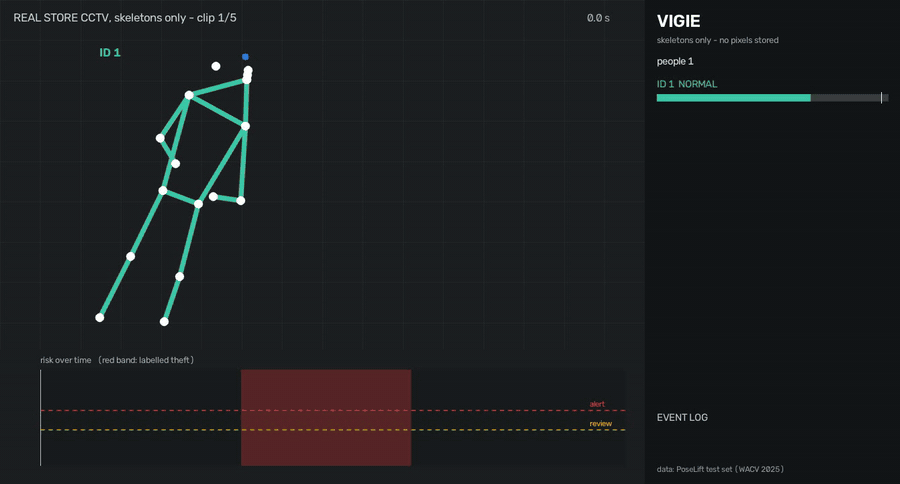
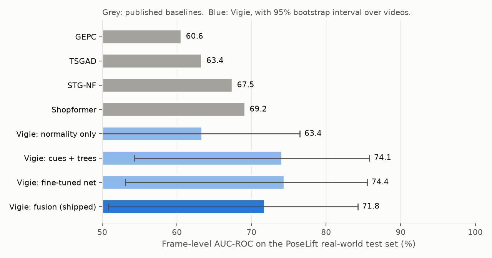
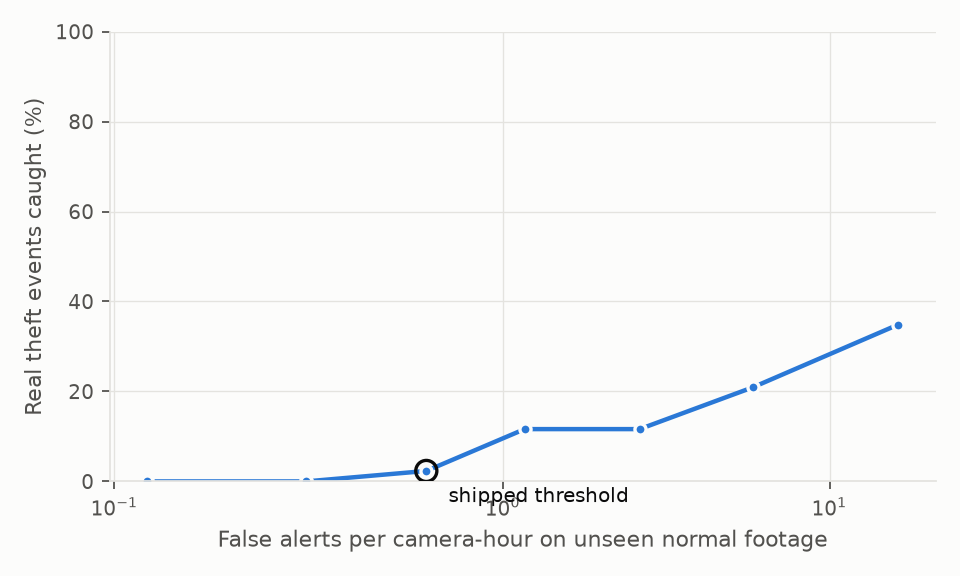
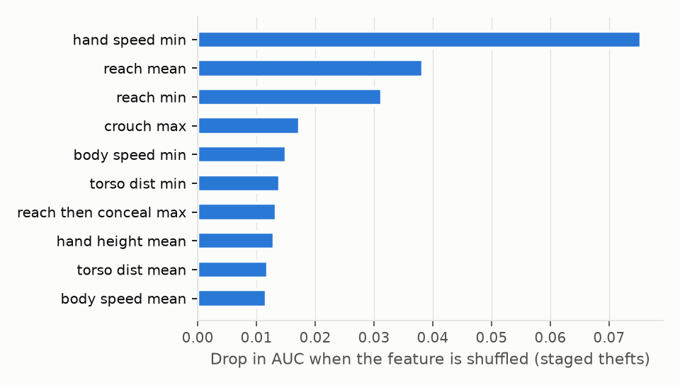
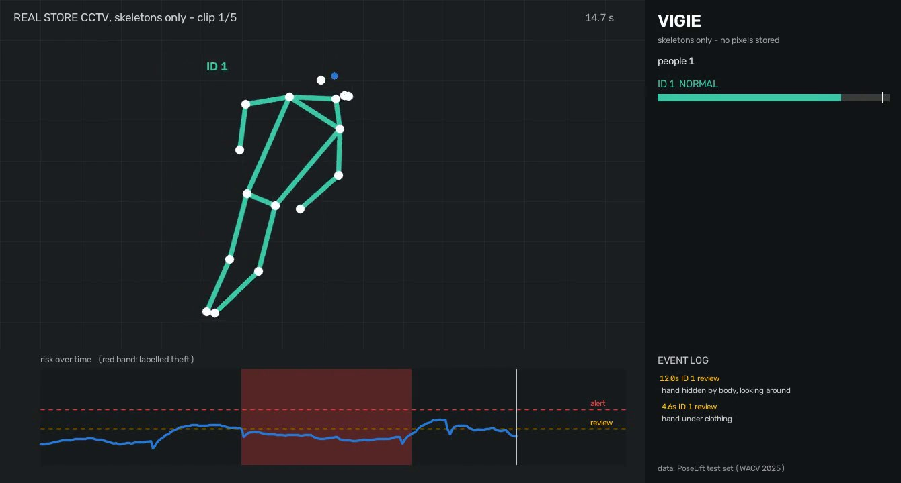
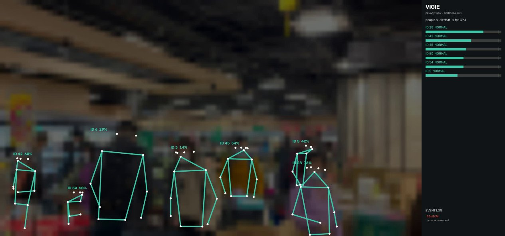

<div align="center">

# Vigie

[](https://github.com/Polluxgnr/vigie/actions/workflows/ci.yml)   

**Privacy-first shoplifting detection from human pose, real-time on a laptop CPU.**

Vigie never stores a face or a pixel: video becomes skeletons at the camera, and every alert
comes with a plain-language reason.



*Real thefts from a real store (PoseLift test set), replayed exactly as Vigie sees them: skeletons
only. Below the scene, each person's risk over time; the red band is the labelled theft.*

**71.8 to 74.4 AUC on real thefts** (best published: 69.2) · **13.7 h of unseen footage** to measure false
alarms · **CPU only** · **no pixel stored**

</div>

---

## Why

Most shoplifting demos are a pretrained detector plus a few hand-written rules, shown on one
clip, with no numbers. In France the CNIL found the market leader's system non-compliant in
2024, mainly because it continuously analyses customers' images.

Vigie takes the opposite stance on every point:

| Typical demo | Vigie |
|---|---|
| Stores or zooms on faces | Converts video to **skeletons**, keeps no pixels, no identity |
| Hand-tuned rule weights | **Learned** models, benchmarked on a public real-world dataset |
| "It works on my clip" | Frame-level AUC with **bootstrap intervals**, **false alarms per hour** on 13.7 h of unseen footage |
| Black-box score | Every alert says **why**: "hand went from shelf to body", "hand kept at pocket 1.8 s" |
| Needs a GPU | Runs on an **Intel i5 laptop CPU** (OpenVINO) |

## Results

All numbers are on the **PoseLift real-world test set**: 47 CCTV clips from a real store, 43 real
theft events, 32% of frames labelled as theft. Nothing was tuned on it.



| Model | Trained on | AUC-ROC (95% CI) | EER |
|---|---|---|---|
| GEPC *(published)* | PoseLift normal clips | 60.6 | 0.38 |
| TSGAD *(published)* | PoseLift normal clips | 63.4 | 0.41 |
| STG-NF *(published)* | PoseLift normal clips | 67.5 | 0.39 |
| Shopformer *(published)* | PoseLift normal clips | 69.2 | n/a |
| Vigie, normality only | PoseLift normal clips (same setting) | 63.5 (43.1 to 76.5) | 0.41 |
| Vigie, normality only | RetailS normal footage (200k windows) | 63.4 (43.7 to 76.5) | 0.41 |
| Vigie, cues + boosted trees | + RetailS staged thefts | 74.1 (54.3 to 85.8) | 0.32 |
| Vigie, fine-tuned transformer | + RetailS staged thefts | 74.4 (53.1 to 85.5) | 0.33 |
| **Vigie, three-way fusion (shipped)** | + RetailS staged thefts | **71.8** (50.8 to 84.2) | 0.35 |

What these numbers say, and what they don't:

- **Learning from staged thefts beats every published unsupervised baseline** by 5 to 7 points.
  The published methods never see a theft; Vigie's heads see 600 *staged* ones from the same store,
  so this is a different (weakly supervised) setting, stated as such.
- **In the published setting** (normal clips only), Vigie's normality model is on par with TSGAD and
  below STG-NF. The masked-prediction idea alone is not enough.
- **The shipped fusion was fixed before looking at test results**, and it is *not* the best row: the
  unsupervised scorer drags it down. Switching to the two supervised heads now would mean choosing
  on the test set, so the report keeps the pre-registered choice and flags this for the next version.
- **47 clips make wide intervals.** Differences of 2 to 3 points between Vigie rows are noise.

### Alerts, not just scores

A store cares about alerts and false alarms, not AUC. Thresholds are set on normal footage only
and measured on **13.7 hours of normal footage no model has seen**:



| Operating point | False alerts per camera-hour | Theft events caught |
|---|---|---|
| Strict (shipped) | 0.6 | 2% |
| ~1 per hour | 1.2 | 12% |
| Review mode | 16 | 35% |

This is the honest weak spot. The test clips are cut tightly around each event (median 2 s), and
an alert needs about 0.5 s of sustained evidence above a threshold that normal shoppers almost never
reach. At store-acceptable false-alarm rates, Vigie today is a **"flag this clip for review" tool,
not an autonomous alarm**. The README of a product would hide this table; this one leads with it.

### What the model actually uses



The most useful cues are **how still the hands are** (concealment is slow and careful), how far the
arms reach (taking from a shelf), crouching, and hands near the torso. Those match how loss-prevention
staff describe the behaviour, which is a good sign the model is not keying on camera artefacts.

### What it looks like

| Real thefts as skeletons (test set) | Live pipeline on real store video (privacy view) |
|---|---|
|  |  |
| [full video](docs/media/replay.mp4): risk curve under each clip, red band = labelled theft | [full video](docs/media/live_pipeline.mp4): YOLO11-pose + ByteTrack + Vigie on a royalty-free [Pexels](https://www.pexels.com/video/customers-shopping-at-supermarket-10901926/) clip, scene pixelated |

**Speed.** Pose estimation with YOLO11n-pose exported to OpenVINO takes about 100 ms per 1080p frame
on an Intel i5-1135G7 (no GPU). Scoring every tracked person adds about 40 ms per person every 0.2 s.
That is about 4 to 8 fps end to end depending on how many people are in view (measured while other
training jobs shared the CPU), below the 15 fps target; see the roadmap.

## How it works

```
video ──► YOLO11-pose ──► ByteTrack ──► per-person skeleton buffer (15 fps)
            │                                   │
            └─ pixels dropped here               ▼
                              body-centric normalisation (rotation, scale, position cancelled)
                                                │
             ┌──────────────────────────────────┼───────────────────────────────┐
             ▼                                  ▼                               ▼
   normality transformer            14 concealment cues + trees       fine-tuned transformer
   (self-supervised, 200k windows   (interpretable: reach-then-        (pretrained on normal,
    from 8M frames of shopping)       conceal, pocket dwell, ...)        tuned on staged thefts)
             └──────────────────────────────────┼───────────────────────────────┘
                                                ▼
                 each score -> "how rare vs normal footage" (percentile) -> fused
                                                ▼
                 per-person hysteresis (needs ~0.5 s of sustained evidence) -> alert + reason
```

Key design choices, each argued in [`docs/design.md`](docs/design.md):

- **Body-centric geometry.** Each skeleton is rotated so its own torso points up, scaled by its
  own torso length and centred on its hips. Camera height, distance and mounting angle cancel
  out (the dataset's cameras are mounted at 90°; a naive model learns the camera, not the body).
- **Three scorers that fail differently.** A self-supervised model flags *unusual* movement
  without ever seeing a theft; interpretable cues provide the *reason*; a classifier pretrained
  on normal behaviour and fine-tuned on staged thefts learns what theft *looks like*.
- **One scale for all scores.** Every score is mapped to its percentile among normal windows that
  no model trained on, so "0.999" means "1 normal window in 1,000 scores this high". Fusion and
  thresholds are then expressed directly as false-alarm rates.
- **Thresholds from normal footage only.** The operating threshold is the lowest one keeping
  false alarms under 1 per camera-hour on held-out normal video. The test set is never used to
  choose anything.

## Data, and how it is used

| Dataset | Content | Role |
|---|---|---|
| [PoseLift](https://github.com/TeCSAR-UNCC/PoseLift) (WACV 2025) | 47 real CCTV clips with real thefts, 104 normal clips, US store, skeletons only | **Test set** (benchmark) |
| [RetailS](https://github.com/TeCSAR-UNCC/RetailS) (IEEE IoT-J 2026) | Same store: ~40 h of normal shopping, 624 staged thefts | Training (normal + staged), calibration, false-alarm measurement |

Checks done before trusting any number:
- PoseLift's test set is **identical** to RetailS's real-world test set (all 47 clips, poses and
  labels). They are counted once.
- Exact-overlap fingerprinting of every 8-frame window found **no shared footage** between any
  training split and the test set (`scripts/check_leakage.py`).
- The normal footage held out from training is split by video into three disjoint thirds:
  negatives for the heads, calibration, and false-alarm measurement.

## Quick start

```bash
git clone https://github.com/Polluxgnr/vigie && cd vigie
pip install -e ".[live]"
vigie run path/to/video.mp4          # privacy-view video + JSON event log in runs/demo/
```

Reproduce the numbers (CPU only, about 3 hours on an i5 laptop):

```bash
python scripts/download_poselift.py          # pose data from the authors' Google Drive
# RetailS: download the archive from the RetailS repo into data/raw/retails/
python scripts/train_normality.py --train retails_fit
python scripts/train_heads.py
python scripts/make_figures.py
python scripts/render_replay.py --out docs/media/replay.mp4
```

## Repository layout

```
src/vigie/
  data.py        dataset loading, pickle-free npz cache
  geometry.py    gap filling, body-centric normalisation, windows
  cues.py        14 interpretable concealment cues
  models/        normality transformer, fine-tuned classifier, boosted trees
  fusion.py      percentile-vs-normal calibration and fusion
  eval.py        benchmark protocol, bootstrap CIs, false alarms per hour, event recall
  explain.py     cue percentiles -> human-readable reasons
  live.py        webcam/video pipeline (YOLO11-pose + ByteTrack + scoring + privacy view)
scripts/         download, train, evaluate, figures, replay rendering
docs/            design, report, figures, media
tests/           pytest suite (geometry invariances, metrics, alert logic, data round-trips)
```

## Roadmap

1. **Drop the unsupervised scorer from the fusion**, then re-validate on a *new* test set (the current
   one has now been looked at).
2. **Event-aware training**: train the heads on whole concealment events rather than 1.6 s windows,
   to lift recall at 1 false alert per hour.
3. **Speed**: export the scorers to ONNX/OpenVINO and score only people near shelves, to reach 15 fps.
4. **Domain shift**: record consented staged scenes in a French store and measure how far the
   US-trained model transfers.

## Limitations, stated plainly

- **One store, US, 47 real test clips.** The confidence intervals are wide, and generalisation to
  other stores (or French stores) is unproven.
- **Pose only.** Vigie cannot see small hand-object details, an item slid into a bag out of view,
  or a swapped price label.
- **Staged thefts are not real thefts.** The supervised heads learn from actors; the gap is
  measured on the real test set, not assumed away.
- **Privacy by design is not legality.** Whether such a system may be deployed in France depends
  on the law (a bill allowing a supervised experiment was being examined in 2026), not on the code.

## Licence and credits

AGPL-3.0 (the live pipeline uses Ultralytics YOLO11, AGPL-3.0). Datasets belong to their authors
and are not redistributed: PoseLift and RetailS by Rashvand, Yao, Danesh Pazho, Alinezhad Noghre
and Tabkhi (UNC Charlotte). Published baselines are quoted from the PoseLift paper.
